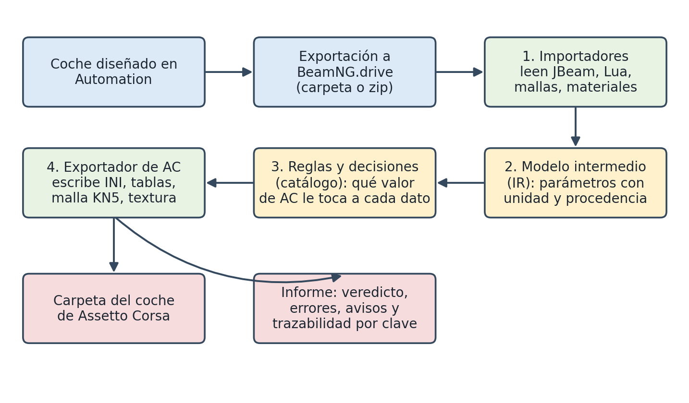

Qué es beam2ac

Del coche de Automation a una carpeta de Assetto Corsa

# El problema

Automation permite diseñar un coche completo (motor, caja, suspensión, carrocería). Puede exportarlo a BeamNG.drive, pero no a Assetto Corsa. beam2ac toma esa exportación de BeamNG y la convierte en un coche que Assetto Corsa pueda cargar.

BeamNG es un puente: el programa no pretende convertir cualquier coche de BeamNG, solo los que vienen de Automation. Por eso la cobertura se mide por versiones del exportador de Automation, no por «compatibilidad con BeamNG».

# Qué entra y qué sale

| Entra | Sale |
|---|---|

| Carpeta (o zip) del vehículo exportado: archivos JBeam, scripts Lua, mallas .dae, materiales y texturas, .pc de configuración. | Carpeta de coche de AC con data/ (INI y LUT), malla .kn5, collider, texturas, ficha de interfaz. |

| Opcional: banco de audio de origen. | Opcional: banco de sonido de AC. |

| Opcional: decisiones humanas sobre datos dudosos. | Informe de exportación con veredicto, errores, avisos y trazabilidad por clave. |

# Flujo general

Cuatro pasos, cada uno con una responsabilidad:

1. Importadores: leen la exportación (JBeam, Lua, mallas) y la traducen a un modelo común. No saben nada de Assetto Corsa.

1. Modelo intermedio (IR): guarda cada parámetro con su valor, unidad, estado (presente, ausente, no aplicable, sin interpretar) y procedencia.

1. Reglas y decisiones: el catálogo decide qué valor de AC corresponde a cada dato. Si no hay regla segura, el dato queda como bloqueo.

1. Exportador de AC: escribe los archivos de destino y comprueba que el paquete sea coherente.

# Principios que conviene recordar

- Nunca inventa valores. Un dato sin regla ni decisión queda bloqueado y se explica por qué; no se sustituye por 0 ni por un valor «razonable».

- Todo es trazable. Cada clave de cada INI generado puede rastrearse hasta el dato de origen y la regla que lo produjo (trace.json).

- Nada se sobrescribe. Los resultados de cada etapa y cada intento de exportación son inmutables; una exportación nueva crea una carpeta nueva.

- No toca el juego. Por defecto no instala nada en Assetto Corsa ni en BeamNG; las carpetas de muestras y de los juegos están protegidas contra escritura.

- Lo no demostrado se dice. El veredicto máximo es «completo sin probar en el juego».

# Qué cubre hoy

La aplicación entiende exportaciones de Automation de tres versiones del exportador (38022, 40340 y 200409) con distintos motores, cajas y tracciones. No todas las combinaciones se convierten: algunas características se reconocen pero quedan bloqueadas porque Assetto Corsa no tiene equivalente (por ejemplo, el convertidor de par de una caja automática, o un eje trasero rígido). El artículo 04 detalla cada caso.

