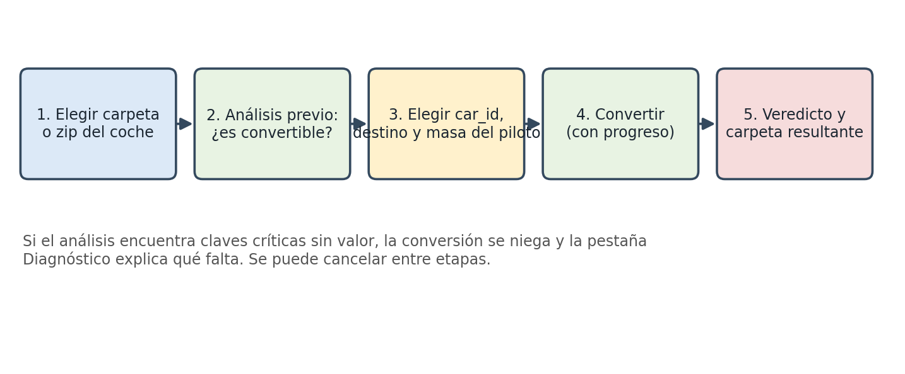

Guía de la aplicación de escritorio

Cómo convertir un coche pantalla por pantalla

La aplicación es un servidor local con interfaz web. Con python -m src.app desktop --window se abre en una ventana propia; sin --window, en el navegador. El artículo 02 explica cómo arrancarla.

# El recorrido más corto: convertir en un paso

1. En la pantalla de inicio (botón Inicio de la cabecera), escribe la ruta de la carpeta del vehículo (o del zip) en «Analizar un vehículo», o usa Elegir carpeta… / Elegir zip… (estos dos solo existen en la ventana nativa).

1. Pulsa Analizar. Aparece un resumen de los componentes detectados (motor, caja, tracción, suspensión, aerodinámica…), las capacidades, el audio de origen y la lista de claves críticas sin valor.

1. Rellena el formulario: car_id (empieza por beam2ac_, solo minúsculas, dígitos y «_»), la configuración (.pc) si hay varias, la masa del piloto, la carpeta de destino y las casillas opcionales.

1. Pulsa Convertir a Assetto Corsa. Un indicador muestra la etapa (de 4); puedes Cancelar conversión.

1. Al terminar verás el veredicto, los botones Abrir carpeta de salida, Abrir build reciente (solo si se promocionó a builds/) y Ver diagnóstico del intento (abre la pestaña «Resultados»).

## Los 4 pasos internos de «Convertir»

- 1/4 Análisis: repite el análisis; si hay errores bloqueantes la conversión se detiene.

- 2/4 Proyecto: crea un proyecto nuevo con nombre libre (nunca sobrescribe uno existente).

- 3/4 Exportación: ejecuta las etapas y escribe un intento en exports/NNN/.

- 4/4 Copia al destino: si el veredicto no es «bloqueado», copia el paquete a <destino>/<car_id>. Sin destino, el paquete queda en la carpeta de exportaciones del proyecto.

# Formulario de conversión: campo a campo

| Campo | Qué hace |
|---|---|

| Nombre del proyecto | Opcional al convertir: vacío = se elige un nombre libre. Nunca sobrescribe un proyecto existente. |

| car_id del coche en Assetto Corsa | Nombre de la carpeta final. Debe cumplir beam2ac_[a-z0-9_]+. Si ya hay un coche con ese nombre instalado en AC, la interfaz avisa y la conversión se rechaza. |

| Configuración (.pc) | Variante del coche que se convierte. Si el origen tiene una sola, se elige sola. |

| Piloto (kg) | Masa del piloto, de 0 a 150. Entra en la masa total del coche. Si cambias el valor, se repite el análisis; el servidor se niega a convertir con una masa distinta a la analizada. |

| Carpeta de destino (opcional) | Carpeta existente donde dejar <car_id>/. Si ya existe allí, se rechaza (no se sobrescribe). Fuera de output/ hay que declararla en BEAM2AC_OUTPUT_ROOTS. |

| Incluir el piloto sentado | Añade pose y manos del piloto leyendo tu instalación local de AC. El resultado no es distribuible. |

| Generar el banco de sonido | Solo aparece si el origen trae audio. El banco se genera en Python (sin FMOD) a partir de las muestras del propio coche. |

| Solo crear el proyecto | Crea el proyecto sin exportar, para trabajar por etapas. |

| Detalles que sorprenden: (1) el análisis lanzado desde la caja de texto usa piloto de 0 kg, mientras que el formulario de «Nuevo proyecto» propone 70 kg; fíjate en el valor antes de convertir. (2) La conversión de un solo paso con zip admite un único vehículo por zip y no usa common.zip. |
|---|

# Trabajar con proyectos (control fino)

Cuando quieres decidir valores dudosos o repetir una exportación, usa la barra lateral Proyectos (botón + Nuevo). Cada proyecto tiene pestañas:

| Pestaña | Para qué sirve |
|---|---|

| Resumen | Etapas con resultado, decisiones, bloqueos, avisos e intentos de exportación; último veredicto. |

| Diagnóstico | Vuelve a analizar el origen del proyecto. Aviso: se muestra «sin las decisiones del proyecto». |

| Asistente | Ejecutar etapas, Ejecutar con modelo 3D y el formulario Exportar (pide marcar «Confirmo: crear un intento de exportación nuevo»). |

| Atributos y decisiones | Editor donde se registran decisiones humanas (valor manual, elegir referencia, no hay correspondencia…). Exige unidades válidas y justificación. |

| Resultados | Tabla de intentos: veredicto, errores, avisos, si es distribuible y fecha. Abre la carpeta en el Explorador o la vista 3D. |

| Vista 3D | Vista esquemática del paquete y acceso al editor de cabina. |

## Editor de cabina

Desde «Vista 3D» → Editar cámaras y piloto se abre un editor con la geometría real del coche. Permite mover cuatro cosas: la cámara de ojos del conductor, la cámara del capó, la del parachoques y las caderas del piloto.

- Guardar crea una versión nueva (nunca se pierde la anterior). Restaurar este devuelve el ítem a su valor original solo en el borrador (hay que pulsar Guardar); Restaurar todo vuelve a los originales y guarda directamente.

- Los cambios se aplican en la próxima conversión o exportación; no modifican paquetes ya hechos.

- Se asocian a la huella del origen: sobreviven a reanálisis y reinicios.

- Assetto Corsa solo lee posiciones de cámara, no orientaciones.

# Panel «Entorno»

El botón Comprobar revisa (solo lectura) si hay instalación de Assetto Corsa, Steam y el catálogo. Úsalo antes de la primera conversión.

# Mensajes de error frecuentes

| Mensaje (resumido) | Causa y solución |
|---|---|

| ya existe el proyecto … no se sobrescribe | Elige otro nombre o deja el campo vacío para que se asigne uno libre. |

| ya existe <destino>/<car_id> | Cambia el car_id o el destino; la aplicación no pisa carpetas. |

| masa del piloto fuera de rango | Usa un valor entre 0 y 150 kg. |

| vuelva a analizar con esa masa antes de convertir | Cambiaste el piloto después de analizar; pulsa Analizar de nuevo. |

| Conversión desactivada: el análisis encontró errores bloqueantes | Revisa «Claves críticas sin valor» y la pestaña Diagnóstico (artículo 04). |

| hay varios vehículos en …: elija uno | Apunta a la carpeta concreta vehicles/<id>/. |

| no declara Automation como origen | El coche está fuera del alcance del conversor. |

