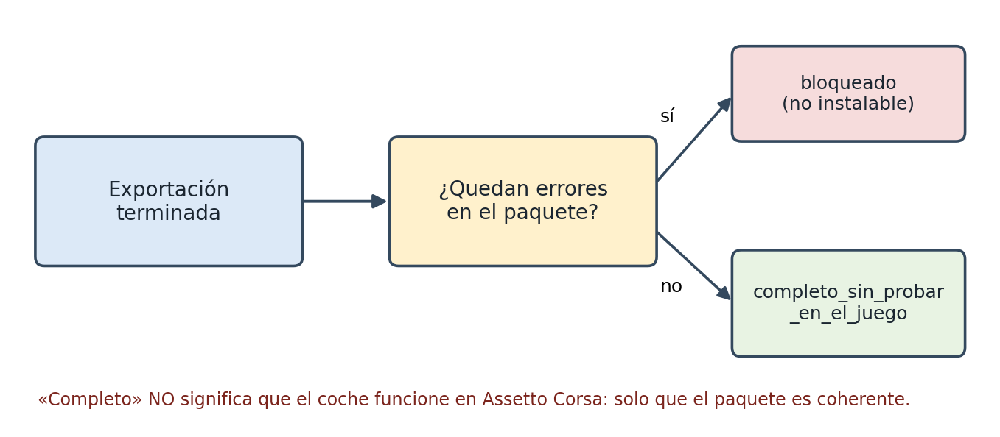

Qué hace en cada caso

Versiones de exportación, veredictos y bloqueos

# Cómo reconoce un coche de Automation

Antes de convertir, el programa comprueba que el origen declare ser de Automation (herramienta, autor y versión del exportador). Si no lo declara, lo trata como fuera del alcance y se niega. Las versiones reconocidas son una lista cerrada: 38022, 40340 y 200409. Una versión nueva no se admite por parecerse: hay que añadirla expresamente.

# Qué cambia entre versiones

| Versión | Rasgos del origen | Situación |
|---|---|---|

| 38022 / 40340 | Motor propio de Automation en Lua; materiales en materials.json; ficha info_<config>.json. | Convierte coches de dos ejes con caja manual o secuencial. Algunos casos (ciertas traseras, p. ej.) requieren trabajo extra y se han resuelto coche a coche. |

| 200409 | Motor genérico; sin ficha de rendimiento; materiales en materials.cs; cajas de doble embrague o automáticas con convertidor. | Varios coches se exportan; los que llevan convertidor de par o eje trasero rígido quedan bloqueados. |

# Qué hace el programa con cada subsistema

| Parte del coche | Qué hace beam2ac | Límites |
|---|---|---|

| Masa y reparto | Suma la masa de todos los puntos del coche y calcula dónde está el centro de gravedad. | La masa de la ficha de Automation puede diferir algo; se usa la medida. |

| Motor | Convierte la curva de potencia y los límites de régimen. El freno motor se aproxima. | El comportamiento a bajo régimen puede diferir del de BeamNG. |

| Caja y tracción | Relaciones de marchas, reparto de tracción, diferenciales. Doble embrague y secuencial soportados. | Assetto Corsa no tiene convertidor de par: esos coches se bloquean. |

| Suspensión y dirección | Calcula las geometrías y rigideces equivalentes a partir de la posición de las piezas. | Eje rígido y algunas configuraciones quedan bloqueadas. |

| Frenos | Par máximo y reparto delantero/trasero. | Térmica y ABS de origen no tienen equivalente. |

| Neumáticos | Ajusta el modelo de AC a mediciones hechas en BeamNG. | Otros detalles (desgaste, térmica) no se reproducen. |

| Aerodinámica | Convierte a alas equivalentes cuando hay datos medidos o fórmula. | Si no hay datos, queda bloqueado. |

| Malla y texturas | El constructor de KN5 en Python coloca cada pieza, nombra los objetos como pide AC y escribe el KN5. | Pinturas por capas se simplifican (se usa la capa base). |

| Sonido | Detecta el audio de origen y genera el banco de sonido en Python (sin FMOD). | Solo el motor; los demás eventos quedan silenciosos. |

# Los veredictos

| Veredicto | Significa | Qué hacer |
|---|---|---|

| bloqueado | Hay al menos un error: el paquete no debe instalarse. | Mira export_report.md, resuelve cada bloqueo (decisión o ampliación del catálogo) y exporta de nuevo. |

| completo_sin_probar_en_el_juego | No hay errores y los archivos son coherentes. No se ha conducido en AC. | Pruébalo con cuidado. Nunca se marca «instalable». |

| Aunque el veredicto sea «completo», el paquete puede comportarse mal en el juego. Los coches validados en Assetto Corsa lo fueron con un banco automático de ensayos (aceleración, frenada, curva) y siguen sin ser una garantía para otros coches. |
|---|

# Qué significa un bloqueo y cómo resolverlo

| Tipo de bloqueo | Qué pasó | Cómo se resuelve |
|---|---|---|

| Valor sin regla | No existe regla para ese dato en esta versión/arquitectura. | Aprobar una decisión manual con justificación, o añadir una regla al catálogo con evidencia. |

| Decisión necesaria | El dato exige elegir entre varias opciones. | Registrar la decisión en la pestaña «Atributos y decisiones». |

| Conflicto | Dos reglas distintas dan valores distintos. | Decidir cuál prevalece. |

| Propuesta pendiente | Hay un valor calculado por una regla de otro tipo de coche; no se aplica sin aprobación. | Aprobarla o rechazarla. |

| Archivo o validación | Falta un archivo o la comprobación del paquete falla. | Corregir el origen o la causa indicada. |

| Puerta de validación | El proyecto exige una comprobación (por ejemplo, una prueba en el juego) que aún no se hizo. | Hacer la prueba y registrarla. |

# Por qué «0» no es un valor por defecto

En Assetto Corsa, un parámetro ausente vale 0, y en muchos casos eso significa un coche sin frenos, sin inercia o sin tracción. Por eso el exportador trata como error la ausencia de claves críticas (frenos, inercia, centro de gravedad, neumáticos, relaciones de caja, etc.) en lugar de dejarlas vacías.

# Opciones que cambian el resultado

- Piloto 3D local: usa archivos de tu instalación de AC; el paquete no se puede distribuir.

- Banco de sonido: manual (--audio-bank) o generado (--audio-build, en Python).

- Masa del piloto: forma parte de la masa total; con piloto distinto de 0 algunas reglas del centro de gravedad dejan de aplicarse y el dato queda bloqueado.

- Cabina: las ediciones guardadas en el editor se aplican en la siguiente exportación.

