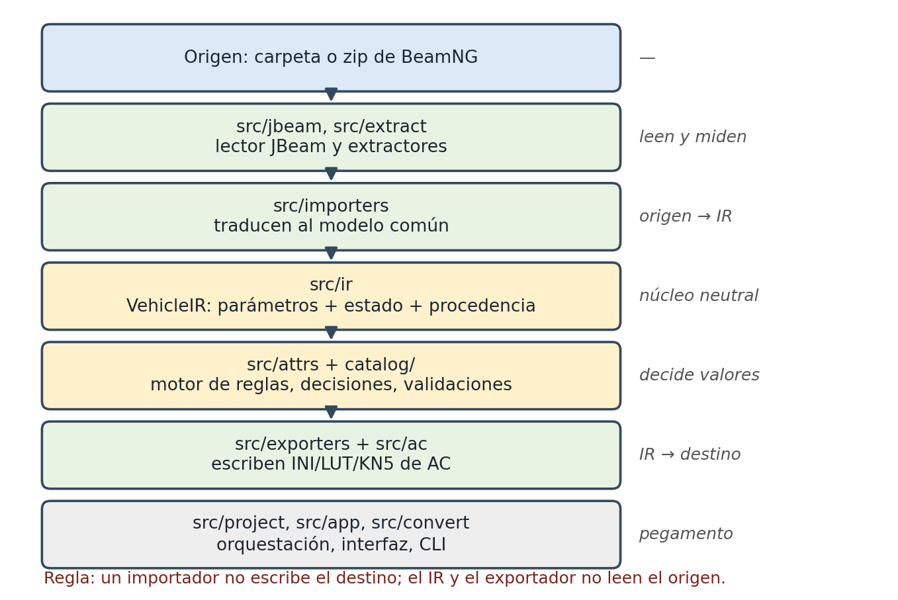

Arquitectura por capas

Para desarrolladores: cómo está organizado el código

beam2ac separa leer el origen, representarlo, decidir qué valores le tocan en AC y escribir el destino. Cada capa solo conoce a la vecina, de modo que cambiar el formato de salida no obliga a tocar los lectores.

# Paquetes y responsabilidades

| Paquete | Responsabilidad |
|---|---|

| src/jbeam | Lector JBeam tolerante (comas que faltan, comentarios, sintaxis laxa), índice de piezas, lectura de .pc, resolución de slots (qué pieza cuelga de cuál). También lee desde zip sin extraer. No se parsea JBeam con regex. |

| src/extract | Extractores que miden o interpretan: nodos, masa, ejes, motor, transmisión, suspensión, dirección, frenos, aerodinámica, pinturas, audio de origen. |

| src/importers | Traducen lo extraído al IR. automation.py define el perfil Automation (y la lista cerrada de versiones); beamng.py el formato BeamNG; measurements.py asocia mediciones hechas en el juego por huella del origen; resources.py recursos. |

| src/ir | VehicleIR: subsistemas como dataclasses cuyos campos son Param (valor + unidad + estado + procedencia). Estados: presente, ausente, no aplicable, sin interpretar. |

| src/attrs y catalog/ | Motor de resolución de atributos: reglas, decisiones, validaciones, transformaciones y unidades. El catálogo en JSON es la fuente de verdad. |

| src/exporters | assetto_corsa.py: del resultado del motor a un modelo de destino. No lee el origen. |

| src/ac | Escritura concreta de AC: INI, tablas, KN5, colliders, luces, cámaras, piloto, validadores del paquete. |

| src/mesh | Plan de mallas y construcción del KN5 (KN5 en Python puro, sin Blender). |

| src/audio | Pipeline WAV → plan → banco generado en Python (sobre un esqueleto versionado) → paquete. |

| src/convert | ConversionSession: analiza un origen y resuelve (inspect) sin escribir física. |

| src/project | Proyectos, etapas, caché, exportación, builds, edición de cabina. |

| src/app | Servidor local, ventana nativa y interfaz (static/). |

| src/lab | Laboratorio aislado de modelos matemáticos. Nada de producción lo importa. |

| src/safe_paths.py | Guardián de escritura (artículo 08). |

# Reglas de capas

- Un importador no escribe el destino. El IR y el exportador no leen el origen. Lo vigila tests/test_ir.py::TestLayering.

- El IR distingue «ausente», «no aplicable» y «sin interpretar», y cada uno lleva un motivo. Un campo desconocido nunca se rellena con un valor por defecto.

- Hay una capa de compatibilidad (legacy_facts) que traduce el IR a los hechos bng.* antiguos para reglas heredadas; el código nuevo debe leer ir.*.

- Las reglas del catálogo son inmutables: una corrección crea una versión nueva que declara qué sustituye (supersedes).

# Qué pasa por dentro al analizar un coche

1. find_source localiza la carpeta vehicles/<id>/ o el zip y elige el .pc.

1. ConversionSession.from_source lee el vehículo con los extractores y los importadores y construye el VehicleIR.

1. El motor de atributos resuelve cada atributo del catálogo contra ese IR (artículo 07).

1. El exportador compone el modelo de destino y el validador comprueba el paquete.

1. inspect_vehicle (en src/app/diagnostics.py) resume el resultado para la interfaz: componentes, capacidades, bloqueos y si hoy es exportable.

# Cómo añadir soporte a algo nuevo

El camino ordenado es siempre el mismo y se resume en las reglas de análisis del proyecto:

1. Localizar la investigación existente sobre ese subsistema antes de repetir trabajo.

1. Identificar el parámetro de origen, su unidad y qué llega realmente al conversor.

1. Identificar el parámetro equivalente de AC; si no existe, declararlo como capacidad ausente.

1. Distinguir lo medido, lo reconstruido y lo hipotético; implementar solo lo que tenga evidencia.

1. Añadir el extractor, el campo del IR, la regla del catálogo (con procedencia y nivel de confianza) y pruebas.

1. Dejar como pendiente, de forma explícita, todo lo no demostrado.

| Una conclusión obtenida con un coche o una versión del exportador no se convierte en regla universal. Toda regla lleva su ámbito (variante, vehículo, familia, arquitectura o genérico) y el motor nunca lo amplía por su cuenta. |
|---|

