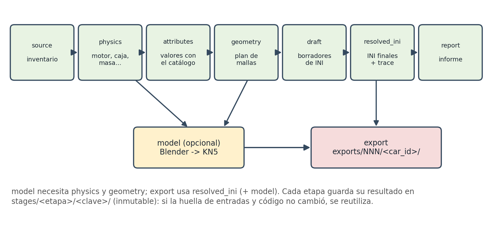
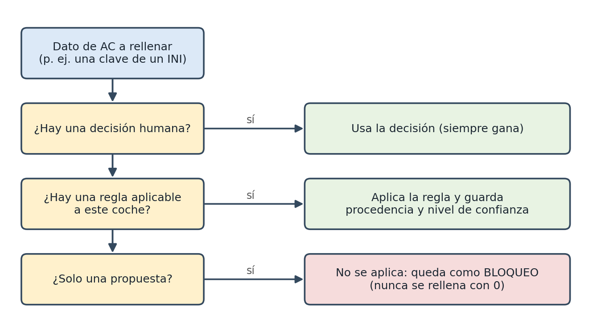

Proyectos, etapas y exportación

Para desarrolladores: el flujo de trabajo por dentro

# Qué es un proyecto

Un proyecto es una carpeta (por defecto bajo output/projects/<nombre>/) que apunta a un origen y guarda todo lo derivado de él. Contiene:

- project.json: origen (carpeta o zip, .pc, common.zip), masa del piloto, notas y datos de referencia opcionales.

- decisions/: decisiones humanas en archivos JSONL de solo añadir. Es la misma carpeta que usa el editor de atributos.

- stages/<etapa>/<clave>/: resultado inmutable de cada etapa.

- exports/NNN/: intentos de exportación.

- validation_gates.json (opcional): puertas de validación que el exportador exige.

# Las etapas

| Etapa | Produce | Depende de |
|---|---|---|

| source | source.json: inventario de archivos por rol, pinturas, ficha. | — |

| physics | Vista previa de la física y borradores de INI/LUT. | source |

| attributes | report.json y summary.md: resolución de atributos con el catálogo. | physics |

| geometry | geometry.json: plan de mallas (sin Blender). | source |

| draft | Borrador de data/ y validación. Cabecera «BORRADOR NO INSTALABLE». | physics |

| resolved_ini | INI finales desde atributos resueltos + trace.json por clave. | physics, attributes |

| report | compatibility.json/.md. | source (los demás, opcionales) |

| model (opcional) | KN5, collider y texturas con Blender. | physics, geometry |

| Los textos de la etapa report («installable_package: False», «la exportación aislada aún no existe») están desactualizados respecto a la exportación real. El docstring de stages.py tampoco menciona resolved_ini ni model. El código manda. |
|---|

# Caché por huella

orchestrator.py calcula para cada etapa una clave sha256 con: nombre y versión de la etapa, hash del código de sus módulos (cierre de importaciones calculado por AST en code_deps.py), huella del origen, masa del piloto, reglas del catálogo y decisiones del proyecto (si la etapa las usa), mediciones, las huellas de referencia y de herramientas externas (Blender, complemento y perfil, para model), el estado de las etapas opcionales y las claves de las etapas de las que depende.

- Si existe stages/<etapa>/<clave16>/ válido, la etapa se marca cached y no se recalcula.

- Se escribe en <clave>.tmp-<pid> y se renombra al terminar. Si falla queda <clave>.failed-N, que no cuenta como caché.

- Nunca se sobrescribe un resultado. Cada ejecución se anota en runs.jsonl.

- Estados de etapa: ok, cached, failed, skipped (por dependencias fallidas).

- Consecuencia práctica: tocar cualquier módulo del cierre de una etapa invalida su caché. Hay pruebas (test_g28_stage_code) que vigilan que la huella cubra todo lo que influye.

# Exportar

python -m src.project export <proyecto> --car-id beam2ac_mi_coche

1. export_project ejecuta las etapas necesarias (con model salvo --no-model).

1. collect reúne los resultados; las claves que en AC valdrían 0 con efecto demostrado (ZERO_IS_WRONG_KEYS) se marcan como errores.

1. write_export escribe exports/NNN/ con el siguiente número libre, ejecuta validate_package y los avisos de prestaciones sobre lo escrito, y sella la carpeta.

1. El veredicto es bloqueado si hay algún error; si no, completo_sin_probar_en_el_juego.

1. Se promociona a builds/ si cumple los criterios (ver abajo).

## Contenido de un intento

| Archivo | Para qué |
|---|---|

| <car_id>/ | El paquete de AC: data/, KN5, ui/, skins/, extension/, sfx/… |

| export_report.md / .json | Veredicto, errores, avisos y resumen. |

| attempt.json | Fecha de creación (único archivo volátil). |

| manifest.json | Se escribe el último y sella la carpeta: car_id, veredicto, installed: false, tested_in_game: false, distributable, opciones, claves de etapa, hash y tamaño de cada archivo. |

python -m src.project inspect <exports/NNN> recalcula los hashes y avisa de cualquier diferencia.

## Validaciones y puertas

- validation_gates.json define comprobaciones externas (por ejemplo, una prueba en el juego). Cada puerta no superada es un error del exportador.

- performance_issues compara las prestaciones calculadas con la ficha de Automation cuando existe; solo emite avisos, nunca bloquea.

- La interfaz se niega a exportar si el precheck tiene errores; la línea de comandos sí genera el intento «bloqueado» (útil para dejar constancia).

# `builds/`: la última versión funcional

Tras cada exportación, builds.py intenta promocionar el intento a builds/<car_id>/: una copia de la última exportación estructuralmente funcional de cada car_id. Solo se promocionan intentos que estén bajo output/: un proyecto en BEAM2AC_OUTPUT_ROOTS nunca llega a builds/.

- Condiciones (check_promotable): esquema y kind correctos, car_id válido, veredicto «completo» sin errores, hay KN5 y data/car.ini, rutas del manifiesto seguras, integridad por hash, sin enlaces simbólicos y coherencia de audio.

- Sustitución segura: bloqueo .lock_<car_id> (caduca a 900 s), copia a carpeta temporal, verificación de hash, y reemplazo con recuperación de huérfanas. Las promociones se registran en promociones.jsonl (no se anota el rechazo de un intento fuera de output/).

- build.json dice qué niveles se alcanzaron: exportación completada, estructuralmente funcional, probado en AC (copiado del manifiesto), validado físicamente (siempre falso), y los del audio: audio_bank_installed (copiado del manifiesto) y audio_listened y audio_validated, siempre falsos.

- python -m src.project builds scan [--apply] recorre el histórico y propone qué promocionar (sin --apply es solo simulación). Agrupa por vehículo, no por car_id, y excluye rutas de ventanas, copias y experimentos.

# Atajo para el usuario: `Workspace.convert`

La conversión de un paso de la interfaz (POST /api/convert) no tiene lógica propia: encadena inspect_vehicle → create_project → export_project → copia a <destino>/<car_id>. Corre en una tarea en segundo plano; solo se permite una tarea por proyecto y la cancelación (POST /api/cancel) se atiende entre etapas (Blender no se interrumpe).

