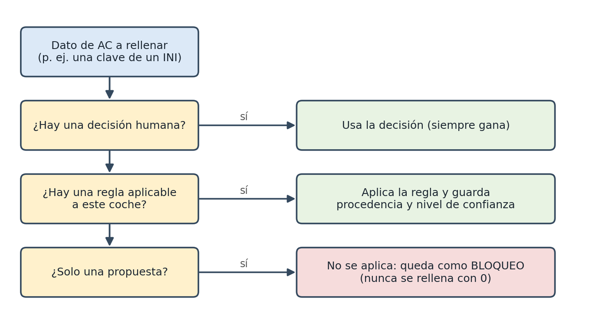

Catálogo y motor de reglas

Para desarrolladores: cómo se decide cada valor

El catálogo (catalog/) es la fuente de verdad sobre cómo un dato del IR se convierte en una clave de Assetto Corsa. El motor (src/attrs/engine.py) lo aplica a cada vehículo y explica cada resultado.

# Qué hay en el catálogo

| Elemento | Contenido |
|---|---|

| attributes/assettocorsa.json | Los atributos de destino: cada clave de cada INI de AC, con su unidad y significado. |

| rules/<id>@<versión>.json | Reglas inmutables. Una corrección es una versión nueva que supersedes la anterior. |

| families.json | Familias de coches (por ejemplo, «exportación de Automation» por procedencia). |

| architectures.json | Arquitecturas (tracción, tipo de caja…) para limitar reglas. |

| capabilities/assettocorsa.json | Qué puede y qué no puede representar AC (p. ej. convertidor de par: no). |

| validations/<vehiculo>.json | Comprobaciones contra valores de referencia. |

| targets/ac_physics.json | Descripción de los archivos de destino. |

| decisions/*.jsonl (por proyecto) | Decisiones humanas, solo añadir. |

# Cómo se resuelve un atributo

1. Decisión humana vigente (ámbito variante o vehículo; gana la más específica). Si una regla da otro valor, se registra el conflicto resuelto por la decisión.

1. Regla aplicable: el vehículo está en su ámbito, no hay excepción, las condiciones y las entradas son válidas. Entre varias gana el ámbito más específico; dos del mismo nivel con valores distintos dan ambiguous.

1. Propuesta: una regla compatible de otro ámbito se calcula, pero no se aplica: queda con source = proposal y requires_approval = true.

1. Nada aplicable: el atributo queda manual_required con el motivo.

Estados de resolución: known, inferred, ambiguous, not_applicable, format_requirement y manual_required. «Propuesta» no es un estado, es el origen del valor.

## Ámbitos y estados de regla

- Ámbitos: variant, vehicle, family, architecture, generic. El motor nunca amplía el ámbito de una regla.

- Estado de regla: pending, provisional, validated, rejected, superseded.

- Tipos: directa, calculada, medida, formato, referencia, aplicabilidad.

- Decisiones: valor manual, elegir referencia, transformación, sin correspondencia, aplazar.

# Confianza E0–E4

| Nivel | Significa |
|---|---|

| E0 | Sin regla. |

| E1 | Regla con evidencia y unidad documentada. |

| E2 | E1 + definición de origen y de destino. |

| E3 | E2 + semántica de origen verificada en código + validación numérica superada, o regla directa, medida o de formato. |

| E4 | E3 + validación superada en este mismo vehículo. |

Un conflicto abierto rebaja un nivel; una validación fallida limita a E1 y marca el atributo como ambiguo.

# Cada regla lleva su procedencia

Cada regla declara evidencia (extraída, calculada, medida, inferida, estimada, manual o de formato), ámbito, condiciones y, si procede, validaciones. En la traza de los INI (trace.json) cada clave queda como requisito_de_formato, decidido, confirmado o inferido.

# Qué hay que hacer para añadir una regla

1. Reúne la evidencia: dato de origen, parámetro equivalente de AC, unidades y, si es posible, un valor de referencia.

1. Crea el archivo de regla con una versión nueva (nunca edites una existente); indica supersedes si sustituye otra.

1. Limita el ámbito al coche, versión del exportador o arquitectura donde la evidencia es válida; las reglas de familia llevan además una condición sobre la versión del exportador.

1. Marca el estado como provisional hasta que haya validación.

1. Añade una prueba con el motor real, con casos positivos y negativos (el dato no debe resolverse como 0 por defecto).

1. Ejecuta la regresión comparando antes y después: solo deben cambiar las claves esperadas.

| Las herramientas de tools/catalog/ que añaden reglas se ejecutan una sola vez: volver a ejecutarlas duplica o rompe versiones. Lee el docstring de cada una antes de lanzarla. |
|---|

# Qué hace la aplicación con esto

El editor «Atributos y decisiones» muestra el resultado del motor: valor, estado, confianza, regla aplicada y motivo del bloqueo. Al guardar una decisión se añade una línea a decisions/ del proyecto y la caché de attributes y resolved_ini se invalida automáticamente por huella.

